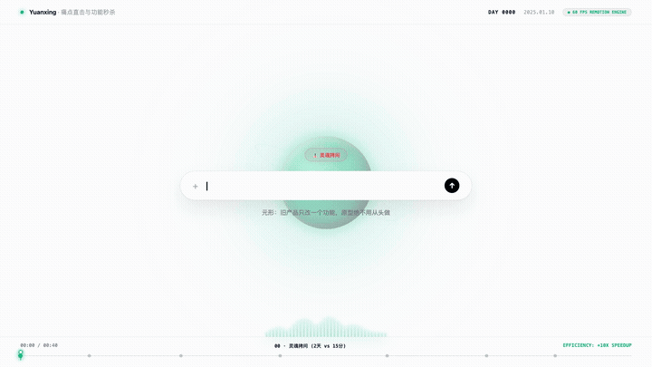
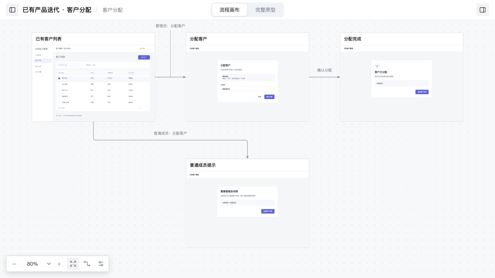

# Yuanxing (元形)

**[English](README.en.md) · [简体中文](README.md)**

**Turn natural language, screenshots, and existing HTML into an interactive prototype & living PRD workbench inside your AI coding agent.**

> **"Change one feature in a legacy app without redrawing the whole prototype from scratch."**

Yuanxing is an open-source Agent Skill (for Claude Code, Cursor, Codex, Antigravity, WorkBuddy, etc.) paired with a zero-dependency local visual workbench (**Node.js 20+ only — uses your existing AI assistant, no extra LLM API key or npm packages required**).

**[Quick Start](#quick-start) · [Interactive Prototype](https://jasperlin2333.github.io/yuanxing/demo/prototype.html) · [Flow Canvas](https://jasperlin2333.github.io/yuanxing/demo/review.html) · [Living PRD Document](https://jasperlin2333.github.io/yuanxing/demo/document.html) · [Showcase Site](https://jasperlin2333.github.io/yuanxing/)**

[](https://jasperlin2333.github.io/yuanxing/demo/prototype.html)

---

## Why Yuanxing?

When iterating on a real product with an AI assistant, pure chat-generated HTML quickly hits four walls:

| Traditional AI Prototyping | Yuanxing Workbench |
| --- | --- |
| Asks AI to redraw an entire legacy system just to add one button or modal | **Screenshot + Incremental HTML**: Keep existing UI screenshots with clickable hotspots and only generate the changed pages |
| Generates 15 disconnected static HTML files with no user flow overview | **3 Synchronized Views in One Project**: **Flow Canvas** (branches & routing), **Interactive Prototype** (real DOM interactions), and **Living PRD** |
| PRD Markdown and prototype UI drift out of sync after the first review | **Two-Way Markdown Sync**: Embed live interactive pages directly inside the PRD; edits in the workbench write back to source `.md` files |
| Stakeholders need Node.js or dev servers just to review a draft | **Single-File Offline HTML Delivery**: Export one compressed, self-contained HTML containing all 3 views — double-click to inspect and re-export offline |

---

## Three Views from One Single Source

| View | Purpose | Live Demo |
| --- | --- | --- |
| **Flow Canvas** | Inspect entry points, conditional branches, edge routing, and reviewer annotations | [Open Flow Canvas](https://jasperlin2333.github.io/yuanxing/demo/review.html) |
| **Living PRD Document** | Read specs side-by-side with embedded live interactive prototypes | [Open Living PRD](https://jasperlin2333.github.io/yuanxing/demo/document.html) |
| **Interactive Prototype** | Click, fill forms, switch role paths (`Admin` vs `Member`), and test real DOM states | [Open Prototype](https://jasperlin2333.github.io/yuanxing/demo/prototype.html) |

[](https://jasperlin2333.github.io/yuanxing/demo/review.html)

The live demos above come from [one self-contained editable project](examples/product-iteration/): a fictional "Assign Customer" iteration where the existing list stays a screenshot while the new assignment modal, result state, and permission branch are interactive HTML.

---

<a id="quick-start"></a>

## Quick Start

### Option A: One-Command Install (Recommended)

Run in your project directory to install Yuanxing into Claude Code, Cursor, Codex, or other compatible agents:

```sh
npx skills add JasperLin2333/yuanxing --skill yuanxing
```

### Option B: Ask Your AI Assistant Directly

Paste this prompt into an AI assistant with local file access, shell execution, and Skill support (Node.js 20+):

```text
Please install the Yuanxing Skill from https://github.com/JasperLin2333/yuanxing
Read SKILL.md, verify Node.js 20+ is available, and install the full skill directory (keeping runtime, scripts, references, and assets) into your agent's Skills directory.
Tell me where it was installed without creating a project yet.
```

You can also download the pre-built Skill packages from [Releases](https://github.com/JasperLin2333/yuanxing/releases/latest) or clone and run `node scripts/install.mjs --target "<Agent Skills Dir>/yuanxing"`.

---

## Typical 5-Step Workflow

1. **Describe the change (or drop a screenshot)**
   > *"Use Yuanxing. Based on this customer list screenshot, add an 'Assign Customer' modal for admins and a permission notice for regular members. Organize the flow canvas and open the workbench."*
2. **Explore & arrange in the local workbench**
   Drag nodes, inspect conditional edges, pin review annotations, or resize layouts directly in the browser (changes auto-save).
3. **Iterate via natural language**
   Tell your AI assistant what controls, fields, or rules to refine — Yuanxing merges changes without overwriting your manual canvas positions or annotations.
4. **Build the Living PRD**
   Ask AI to organize background, scope, and business rules with live prototypes embedded right next to each section; inline text edits write back to your source Markdown.
5. **Export one offline HTML to share**
   Click **Export HTML** (choosing Flow Canvas, Living PRD, or Interactive Prototype as the landing view) to deliver a single self-contained file to teammates or clients.

---

## Local CLI & Demo Playground

```sh
git clone https://github.com/JasperLin2333/yuanxing.git
cd yuanxing
npm test

# Launch the interactive example in your local editable workbench
node scripts/yuanxing.mjs init ./my-iteration --template iteration
node scripts/yuanxing.mjs open --root ./my-iteration --reuse

# Export a self-contained single-file HTML
node scripts/yuanxing.mjs export --root ./my-iteration --view prototype
```

---

## Ecosystem Companion

Working across multiple AI sessions or switching between **Claude Code, Cursor, Codex, and Antigravity**? Pair Yuanxing with our companion Skill **[Context Continuity](https://github.com/JasperLin2333/context-continuity)** to keep one authoritative source of truth and structured handoff contracts so a new agent session never overwrites settled decisions:

```sh
npx skills add JasperLin2333/context-continuity --skill context-continuity
```

---

## Documentation & License

- [Skill Entry (SKILL.md)](SKILL.md) · [Project Format](references/project-format.md) · [Workbench Guide](references/workbench.md) · [Document & Export Protocol](references/document.md)
- Contributing & issues: [CONTRIBUTING.md](CONTRIBUTING.md) · [GitHub Issues](https://github.com/JasperLin2333/yuanxing/issues)
- License: [MIT](LICENSE) · Third-party components (`libavoid`, `fflate`, `draw.io` routing): [THIRD_PARTY_NOTICES.md](THIRD_PARTY_NOTICES.md)
