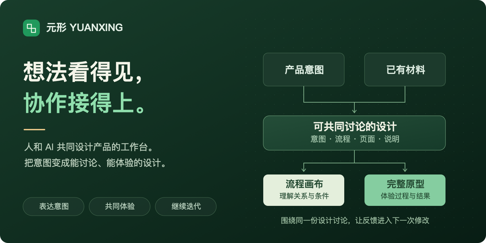
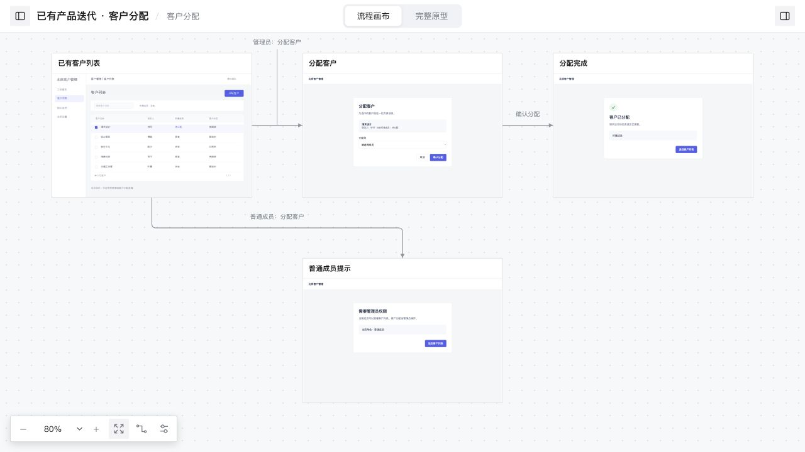
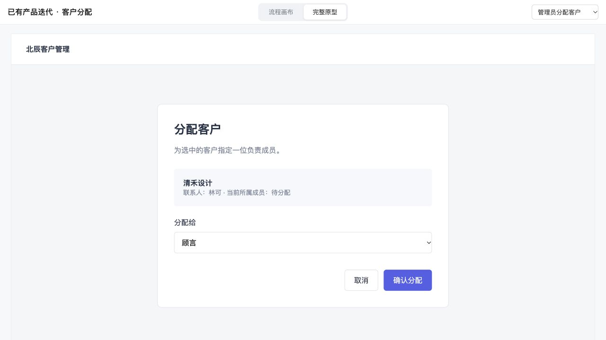

# 元形 Yuanxing

**人和 AI 共同设计产品的工作台。**

把产品想法变成团队能讨论、能体验、能继续修改的共同设计。用原型、流程和说明表达意图，让人和人、人和 AI 围绕同一份设计继续推进。

**[直接体验](https://jasperlin2333.github.io/yuanxing/demo/prototype.html) · [查看画布](https://jasperlin2333.github.io/yuanxing/demo/review.html) · [开始使用](#start) · [产品介绍](https://jasperlin2333.github.io/yuanxing/) · [查看发布](https://github.com/JasperLin2333/yuanxing/releases/latest)**

[](assets/readme-hero.svg)

## 把脑中的产品想法，变成大家能共同理解的设计

同一句“增加客户分配功能”，产品、研发、测试和 AI 脑中可能是不同的方案：谁能操作、从哪里进入、结果是什么、哪些条件会改变流程？

元形把意图表达为可查看、可操作的原型与流程。团队可以据此讨论，AI 可以按明确的需求和反馈继续修改；实际走一遍，也会发现原来没想到的条件和分支，为判断与取舍补充信息。

**让理解发生在同一份设计里，让反馈进入下一次修改。** 已有截图与 HTML 可以继续复用，只补这次变化；新产品也可以从空白开始。

| 你要推进的工作 | 元形帮你怎么做 |
| --- | --- |
| **表达产品意图** | 把需求、截图和已有页面组织成可讨论的设计，让入口、操作和结果具体可见 |
| **让团队形成共同理解** | 在同一画布上查看页面关系、关键条件与批注，围绕具体流程交流 |
| **和 AI 一起继续设计** | 用自然语言描述新增或修改，让 AI 更新页面与交互，保留已有设计和人工整理 |
| **通过体验补充判断** | 点击、选择、输入，走完已设计的路径，发现遗漏与需要进一步讨论的地方 |
| **把设计传给下一位** | 导出单个 HTML，让同事离线查看、体验并反馈 |

你也可以直接拖动、连线、打点批注，与 AI 继续打磨同一份设计。

## 先看全局，再实际操作

### 流程画布：把入口、分支和结果放在一起

把页面关系、条件分支和说明放在一起，帮助团队对齐对流程的理解。拖动整理布局、连接操作路径、在页面上打点说明；局部修改保留已有的人工整理。

[](https://jasperlin2333.github.io/yuanxing/demo/review.html)

**[打开这个流程画布 →](https://jasperlin2333.github.io/yuanxing/demo/review.html)**

### 完整原型：从入口到结果，像使用产品一样体验

把设计走一遍，检验自己的理解，也给讨论提供具体依据。一键切换视图，直接操作页面中的控件；按 Esc 回到画布，继续推演和讨论。

[](https://jasperlin2333.github.io/yuanxing/demo/prototype.html)

**[直接体验这个原型 →](https://jasperlin2333.github.io/yuanxing/demo/prototype.html)**

截图来自公开的“客户分配”示例，界面与数据均为虚构。两种视图共用[同一份可编辑项目](examples/product-iteration/)。

## 拿一个已有功能，走完一段完整流程

**需求：给已有客户列表增加“分配客户”。**

| 阶段 | 怎么设计 |
| --- | --- |
| **复用旧页面** | 保留客户列表截图，为“分配客户”按钮设置热点 |
| **补上新操作** | 用 HTML 生成分配表单，让管理员选择负责成员 |
| **串起操作结果** | 确认后展示所选成员，再返回客户列表 |
| **讲清关键分支** | 普通成员从同一入口进入，展示对应权限提示 |

不必先准备完整 PRD，也不必一次重画全部页面。先让这次变化表达清楚，在讨论和体验中发现问题，再把已确认的反馈落实到同一份源项目。

## 一份设计，两种离线交付

| 流程评审工作台 | 完整原型 |
| --- | --- |
| 看页面关系、条件分支和说明 | 从指定入口连续操作 |
| 适合推演、讲解和方案评审 | 适合演示、试用和收集反馈 |
| 保留流程画布与页面批注 | 专注产品页面与真实操作 |

两种视图都能导出为**单个 HTML 文件**，内含页面、图片、脚本和样式。接收者在浏览器打开即可使用，无需安装元形或启动服务。导出自动排除回收站内容，保留原型交互需要的内部状态。

右上角「⋯ → 开发交付模式」默认关闭，需要交付局部 UI 时再开启：选择区域与父级层级，复制包含源文件、DOM、样式和说明的交付内容，或下载片段 HTML。页面说明继续直接编辑。需要跨页面修改时，在当前对话中说明范围，由 Agent 结合业务含义查找关联内容并同步，交付时说明影响范围与差异。

## 人和 AI 同时修改

页面和画布内容变化会自动同步；输入、拖动、编辑批注及完整原型体验期间暂缓更新。工作台代码更新稳定后，在空闲时自动重载，恢复模块、页面、选择和画布位置。服务代码更新由启动器自动重启，保存请求会先处理完，已有页面继续使用原会话令牌。

从旧版升级后，关闭原工作台服务并重新启动一次，即可启用新的自动更新机制。离线 HTML 保留导出时的内容；更新后需重新导出。

你调整布局、AI 修改文案等独立变化会自动合并；双方修改同一字段时，保留双方内容，选择【保留我的冲突项】或【采用外部冲突项】，也可导出双方修改。AI 调整编排通过 `apply` 命令提交共同基线与修改结果；直接覆盖文件不经过合并保护。

合并保护针对页面编排、说明和布局；同一个源 HTML 被多个编辑器直接改写时，仍需协调修改范围。

## 多个项目，放进同一个工作台

对 AI 说：“再建一个用户门户项目，加到当前工作台。”它会创建并登记项目；顶栏切换项目，各自保存页面、画布、批注和导出。

同一产品的多个模块可以组成完整原型，由 AI 串联已设计的按钮与导航。不同产品可以独立保存与迭代，在同一个工作台中切换。

<a id="start"></a>

## 开始使用

把这段话发给能够读写本地文件、运行命令的 AI 助手：

```text
请安装 https://github.com/JasperLin2333/yuanxing 中的元形 Skill。
先阅读 SKILL.md，按当前宿主的 Skill 目录规范安装，保留随包运行时与资源。
安装后，基于我提供的需求和已有材料，生成团队可讨论的流程画布和可体验的原型；已有产品只修改本次涉及的部分。
```

也可以在项目目录中运行，按提示选择 AI 助手：

```sh
npx skills add JasperLin2333/yuanxing --skill yuanxing
```

安装后，从一个具体需求开始：

> 使用元形。基于这张已有客户列表，只设计“分配客户”这次改动，保留其他区域。把管理员和普通成员的流程放到画布上，并导出能独立体验的原型。

**需要 Node.js 20+。使用你现有的 AI 助手，无需额外配置模型 API Key，也无需安装 npm 运行依赖。**

## 为反复打磨准备

画布上的布局、连线和批注可以继续编辑，局部改动保留已有整理；完整原型与导出使用同一份设计，讨论后的修改继续回到源项目。

项目包含 [179 项自动化测试](test/)，覆盖连线与分叉、撤销、交互状态、多项目隔离、版本冲突和离线导出。日常操作细节见[工作台手册](references/workbench.md)。

<details>
<summary><strong>先在本地跑一个案例</strong></summary>

```sh
git clone https://github.com/JasperLin2333/yuanxing.git
cd yuanxing
node scripts/yuanxing.mjs init ./my-iteration --template iteration
node scripts/yuanxing.mjs serve --root ./my-iteration --open
```

打开后直接整理画布，或让 AI 阅读 [SKILL.md](SKILL.md)，继续修改项目。新建空白项目可使用：

```sh
node scripts/yuanxing.mjs init ./my-prototype --name "我的产品"
```

</details>

<details>
<summary><strong>手动安装与导出</strong></summary>

把完整 Skill 安装到宿主的技能目录；目标目录存在时会保留原安装并停止：

```sh
node scripts/install.mjs --target "/你的宿主/skills/yuanxing"
```

导出当前项目：

```sh
node scripts/yuanxing.mjs export --root ./my-iteration --view review
node scripts/yuanxing.mjs export --root ./my-iteration --view prototype
```

文件保存到项目的 `dist/`，顶栏“导出 HTML”菜单也提供这两种方式。

多项目工作区：

```sh
node scripts/yuanxing.mjs workspace add --workspace ./my-workspace.json --root ./my-iteration --id crm
node scripts/yuanxing.mjs workspace add --workspace ./my-workspace.json --root ./my-portal --id portal
node scripts/yuanxing.mjs serve --workspace ./my-workspace.json --open
```

</details>

<details>
<summary><strong>输入材料、文件保存与批注</strong></summary>

当前支持自包含 HTML、本地 CSS、图片、普通 JavaScript，以及 PNG、JPEG、WebP 截图。框架工程、外部 CDN、真实登录和网络接口需要先适配，具体见[项目格式](references/project-format.md)。

项目文件保存在你选择的本地目录。工作台只监听本机地址；模型如何处理输入材料，取决于你使用的 AI 宿主与模型服务。

批注用来说明与评审，保留在同一份项目中，不会自动转成 AI 的修改指令。

</details>

---

**先拿一个你熟悉的功能试试。** [体验完整原型](https://jasperlin2333.github.io/yuanxing/demo/prototype.html)，或在 [Issues](https://github.com/JasperLin2333/yuanxing/issues) 分享你的具体场景和改进建议。

希望参与开发，可查看[贡献与维护说明](CONTRIBUTING.md)。

相关工具：[上下文协作](https://github.com/JasperLin2333/context-continuity) 关注 Agent 之间的任务接续，让当前目标、判断依据与已确认决定被下一位继续使用。

主代码采用 [MIT](LICENSE) 许可证；附带组件的来源与许可见[第三方说明](THIRD_PARTY_NOTICES.md)。
