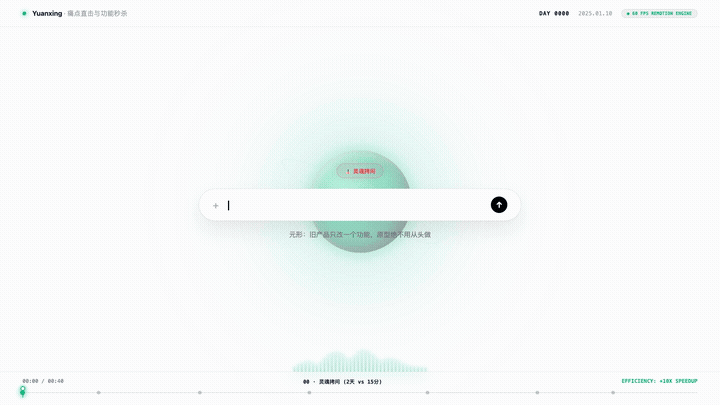
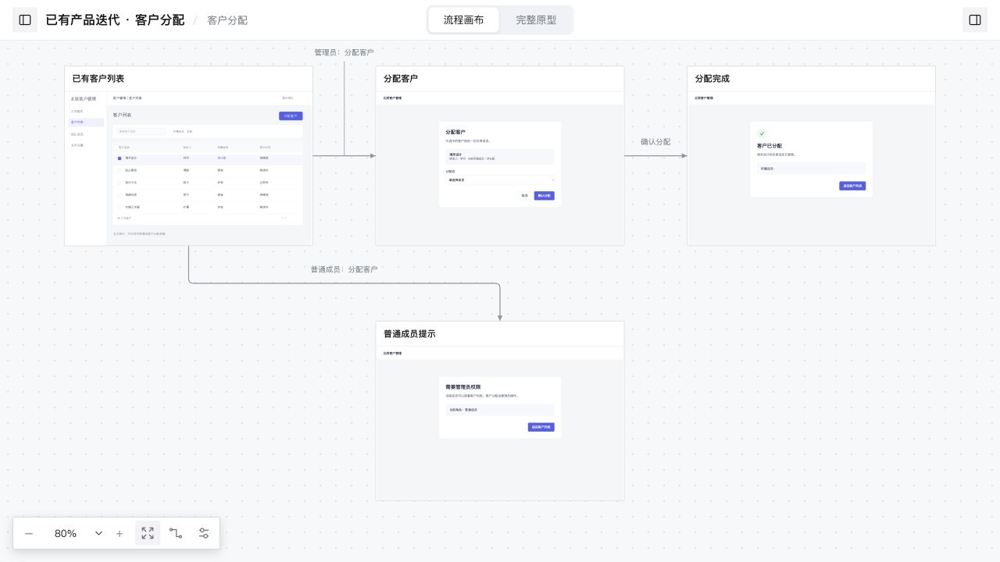

# 元形 Yuanxing

**用自然语言，把需求做成可交互原型。**

元形是给 AI 助手用的开源原型 Skill，配套一个本地可编辑工作台。你在 AI 助手里说明需求、提供截图或已有页面，AI 负责制作和修改；你在浏览器里查看流程、体验原型、编辑说明，再把反馈交给 AI 继续调整。

可以从一个想法开始，也可以只改已有产品的一小部分。需要评审时，把原型与需求说明组织在一起；需要分享时，导出一个 HTML 文件发给同事。

**[开始使用](#start) · [体验完整原型](https://jasperlin2333.github.io/yuanxing/demo/prototype.html) · [查看流程画布](https://jasperlin2333.github.io/yuanxing/demo/review.html) · [阅读交互文档](https://jasperlin2333.github.io/yuanxing/demo/document.html) · [产品介绍](https://jasperlin2333.github.io/yuanxing/)**

[](https://jasperlin2333.github.io/yuanxing/demo/prototype.html)

官网提供可直接打开的示例。制作自己的项目，需要在具备本地文件读写、命令执行和 Skill 使用能力的 AI 助手中安装元形。运行环境为 **Node.js 20+**；使用你现有的 AI 助手，无需为元形另配模型 API Key，也无需安装 npm 运行依赖。

<a id="start"></a>
<a id="workflow"></a>

## 使用流程

**安装一次 → 给出需求与材料 → 体验并修改 → 整理需求 → 导出分享。** 后续迭代继续使用同一个源项目。

### 1. 把元形安装到 AI 助手

将下面的话发给你准备使用的 AI 助手：

```text
请安装元形 Skill：https://github.com/JasperLin2333/yuanxing
先阅读仓库中的 SKILL.md，确认当前环境能读写本地文件、运行 Node.js 20+，并使用本地 Skill。
按当前助手的 Skill 目录规范安装完整技能，保留运行时、脚本、参考资料和资源。
完成后告诉我安装位置和如何调用，先不创建原型项目。
```

安装完成后，在同一个助手里说“使用元形”即可开始。若助手只能聊天，不能操作本机文件和命令，需要先切换到具备这些能力的工作环境。

也可以从 [Releases 下载 Skill 安装包](https://github.com/JasperLin2333/yuanxing/releases/latest)，按宿主的本地 Skill 安装方式接入；包中的整个 `yuanxing` 目录需要保留。手动安装与更新命令见下方[补充操作](#manual)。

### 2. 把需求和材料交给 AI，先做一段主流程

在 AI 对话中提供：**想解决什么问题、本次做哪些内容、已有材料，以及项目保存位置**。没有截图或完整 PRD，也能从文字需求开始；已有产品可以提供截图、HTML 或需求文档。

从零开始，可以这样说：

```text
使用元形。在当前工作目录新建“客户分配”原型项目。
管理员需要从客户列表进入分配表单，选择负责成员，确认后查看结果并返回列表。
先做这段主流程，组织到流程画布，并打开可编辑工作台。
```

修改已有产品，可以把截图或 HTML 一起发给 AI：

```text
使用元形。基于我提供的客户列表截图，只增加“分配客户”这次改动，保留其他区域。
管理员可以选择负责成员并查看分配结果；普通成员从同一入口进入时展示权限提示。
在当前工作目录新建原型项目，复用旧页面，补上新页面，并打开可编辑工作台。
```

AI 会在指定位置保存项目、制作页面和交互，并提供工作台入口。首次启动本地工作台时会自动开页；服务已运行时复用原入口。页面关闭后，直接让 AI“重新打开这个项目的工作台”。

### 3. 在工作台体验，在 AI 对话里提出修改

打开「完整原型」，实际点击、输入和选择，检查已设计的流程。切回「流程画布」，查看页面关系和分支，也可以直接拖动整理、连线、粘贴图片、编辑说明和打点批注。

| 你想做的事 | 在哪里操作 |
| --- | --- |
| 调整画布位置、连线或页面说明，粘贴图片、标注问题 | 浏览器中的本地工作台，修改自动保存 |
| 新增页面、修改页面里的控件、补充业务规则或调整跨页交互 | 回到 AI 助手，说明具体页面与期望变化 |
| 修改需求文档文字 | 工作台直接编辑，或让 AI 修改对应正文；章节与布局交给 AI 编排 |

例如，体验后继续对 AI 说：

```text
继续修改刚才的客户分配项目：
分配表单增加搜索成员的输入框；取消后返回列表。
保留我在画布里调整的位置，并同步这次涉及的需求说明。
```

AI 修改完成后，先切回「流程画布」，等待工作台加载变化，再进入「完整原型」体验。**批注用于记录意见，不会自动发给 AI 或触发修改**；需要采纳的意见仍在 AI 对话中说明。

### 4. 需要评审时，把原型和规则放在一起

主流程能体验后，可以让 AI 按讲解顺序整理需求文档。预评审只需主流程和必要说明，后续再逐步补充字段、规则与边界。

```text
把客户分配的背景、目标、功能范围和已确定的规则组织成需求文档。
在相关说明旁引用现有原型，便于边读边操作；画布只保留核心流程和说明。
尚未决定的规则放在对应功能旁，标为待讨论。
```

已有 Markdown PRD 可以按章节引用，在工作台修改被引用的文字会写回原文。自由编排的文字、页面说明和画布摘要保存在工作台项目中，不会自动汇总成另一份 Markdown。AI 会沿用你选定的正文来源继续维护。

### 5. 需要分享时，导出一个 HTML 文件

在工作台顶栏选择「导出 HTML」，按同事最先需要看的内容选择「完整评审台」「需求文档」或「完整原型」。也可以直接告诉 AI：

```text
把当前客户分配项目导出为一个离线 HTML，打开时先展示完整原型。
```

**一次导出得到一个自包含 HTML，文件里保留三种视图，导出类型决定最先打开哪一种。** 同事在浏览器中打开即可查看和体验，无需安装元形、Node.js 或启动服务。

离线分享中的正文和源数据只读。收到反馈后，回到原项目继续修改；需要发送最新版时再次导出。已经发出的 HTML 保留导出时的内容，不会自动同步。

## 同一份项目，三种查看方式

| 视图 | 用来做什么 | 示例 |
| --- | --- | --- |
| **流程画布** | 看入口、页面关系、条件分支和批注，整理评审主流程 | [打开画布](https://jasperlin2333.github.io/yuanxing/demo/review.html) |
| **需求文档** | 阅读背景与规则，把正文、表格、页面和组件放在一起，边读边操作 | [打开文档](https://jasperlin2333.github.io/yuanxing/demo/document.html) |
| **完整原型** | 从入口连续操作，检查页面、输入和跳转是否表达了预期设计 | [打开原型](https://jasperlin2333.github.io/yuanxing/demo/prototype.html) |

[](https://jasperlin2333.github.io/yuanxing/demo/review.html)

公开示例演示“给已有客户列表增加分配功能”：旧列表使用截图，分配表单与结果页使用 HTML，并展示管理员和普通成员的不同路径。界面与数据均为虚构，三个视图来自[同一份可编辑项目](examples/product-iteration/)。

## 下次继续时，改哪一份？

| 你手里的内容 | 用途 |
| --- | --- |
| **本地源项目目录** | 保存页面、资源、编排和说明，是后续修改的对象 |
| **浏览器中的本地工作台** | 查看和编辑源项目；重新打开后可继续工作 |
| **导出的 HTML** | 发给同事查看与体验，是当时内容的快照 |

在同一个对话里说“继续修改这个项目”；换对话或换助手时，提供**原项目目录和本次要改的内容**，让 AI 先读取现有项目。继续打磨一个需求时，沿用同一份项目和正文。

需要把项目交给另一位继续制作时，一并交接源项目及其使用的需求文件。离线 HTML 顶栏的「打开工作台」会唤起接收者本机已配置的工作台，不会把收到的 HTML 自动导入为可编辑项目；首次设置见[本机启动说明](references/agent-adaptation.md#本机启动与桌面入口)。

## 常见问题

**可以复用什么材料？**

可以使用文字需求、自包含 HTML、本地 CSS、图片、普通 JavaScript，以及 PNG、JPEG、WebP 截图。截图可绑定点击热点，与新增 HTML 页面接成同一流程。已有框架工程、外部 CDN、真实登录或网络接口，需要按具体项目适配，见[项目格式](references/project-format.md)。

**我和 AI 可以同时改吗？**

画布位置、说明等独立字段的修改可以合并。同一内容发生冲突时，工作台保留双方修改，由你选择；让 AI 继续按元形 Skill 修改项目即可。同一个 HTML 源文件被不同编辑器同时改写时，需要协调修改范围。

**材料保存在哪里？**

项目保存在你选择的本地目录，工作台监听本机地址。AI 如何处理对话与输入材料，由你使用的助手和模型服务决定。

**同事能读取交付数据吗？**

导出的 HTML 同时携带可提取的需求、页面、状态与跳转数据。需要提取局部界面时，也可开启工作台右上角「⋯ → 开发交付模式」。数据格式和转换边界见[文档与交付格式](references/document.md)。

<a id="manual"></a>

## 补充操作：手动安装与本地示例

日常制作和修改可以直接对 AI 说。以下命令供希望手动操作的人使用。

<details>
<summary><strong>从源码安装或更新 Skill</strong></summary>

先获取源码，在仓库目录运行安装脚本；将目标路径替换为你的 AI 助手实际使用的 Skill 目录：

```sh
git clone https://github.com/JasperLin2333/yuanxing.git
cd yuanxing
node scripts/install.mjs --target "<助手的Skills目录>/yuanxing"
```

目标已存在时，先检查，再备份更新：

```sh
node scripts/install.mjs --target "<助手的Skills目录>/yuanxing" --check
node scripts/install.mjs --target "<助手的Skills目录>/yuanxing" --update
```

安装后有本地改动时，脚本会先列出差异并停止，保留原安装。更新流程见[安装与版本说明](references/agent-adaptation.md#分发与版本)。

</details>

<details>
<summary><strong>在本地打开可编辑示例</strong></summary>

在已获取的元形源码目录运行：

```sh
node scripts/yuanxing.mjs init ./my-iteration --template iteration
node scripts/yuanxing.mjs open --root ./my-iteration --reuse
```

新启动服务时自动打开浏览器；已有服务时输出原入口。要手动重新打开页面，去掉 `--reuse`。

如果还要另建一个空白项目，使用另一个空闲端口（示例为 4319）：

```sh
node scripts/yuanxing.mjs init ./my-prototype --name "我的产品"
node scripts/yuanxing.mjs open --root ./my-prototype --port 4319 --reuse
```

之后可以让 AI 读取 [SKILL.md](SKILL.md)，在这个项目中继续制作页面与交互。

</details>

<details>
<summary><strong>手动导出项目</strong></summary>

在元形源码或完整 Skill 目录运行，`--root` 指向你的项目：

```sh
node scripts/yuanxing.mjs export --root ./my-iteration --view prototype
```

默认保存到项目的 `dist/prototype.html`。希望打开时先展示评审画布或需求文档，将 `--view` 改为 `review` 或 `document`；默认文件名分别为 `workbench.html`、`document.html`。覆盖已有生成文件时，在确认后加 `--replace`。

</details>

更多操作见[工作台手册](references/workbench.md)，开发维护见[贡献说明](CONTRIBUTING.md)。遇到问题可在 [Issues](https://github.com/JasperLin2333/yuanxing/issues) 描述具体场景。

主代码采用 [MIT](LICENSE) 许可证；附带组件的来源与许可见[第三方说明](THIRD_PARTY_NOTICES.md)。
