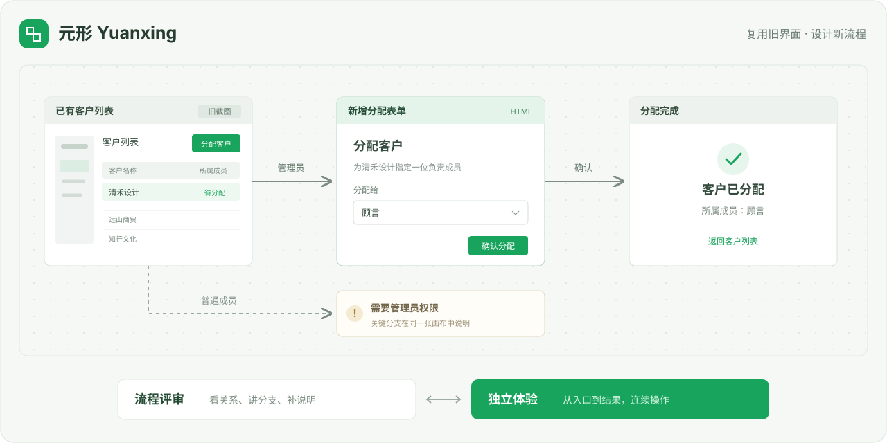

# 元形 Yuanxing

### AI 时代的 Axure，让想法变成可评审、可体验的产品流程。

给已有产品加一个功能，不必先重做整套界面。把现有截图或 HTML 放进来，用自然语言补上本次改动，再把入口、操作、结果和关键分支连成完整流程。

**[立即体验原型](https://jasperlin2333.github.io/yuanxing/demo/prototype.html) · [查看流程画布](https://jasperlin2333.github.io/yuanxing/demo/review.html) · [产品介绍](https://jasperlin2333.github.io/yuanxing/) · [开始使用](#start) · [下载离线包](https://github.com/JasperLin2333/yuanxing/releases/latest)**



*工作方式示意：已有页面可以继续用截图，本次变化用 HTML 实现，两者一起组成可操作的用户流程。*

## 把时间花在这次要设计的变化上

你可能正遇到这些情况：旧系统只改一个弹窗，却得先复刻整页；AI 生成了几个页面，评审时仍要靠口头解释它们怎么连起来；方案讨论清楚了，发给同事的文件又无法直接体验。

元形把这些工作放到同一个原型项目里：

| 你要完成的工作 | 用元形怎么做 |
| --- | --- |
| 给旧产品增加功能 | 复用原页面截图或 HTML，只生成需要变化的界面 |
| 想清楚用户怎么走 | 把页面、操作和关键条件放在流程画布上推演 |
| 让评审者看懂方案 | 沿着画布讲流程，在页面上打点补充说明 |
| 让同事实际试一遍 | 切到独立原型，从入口连续操作 |
| 发给别人继续讨论 | 导出单个 HTML 文件，离线打开即可查看 |

新产品也可以从空白开始。你可以让 AI 生成和修改页面，也可以自己拖动、对齐、连线与批注；局部修改保留已有的人工整理。

## 看一个完整例子

**需求：给已有客户列表增加“分配客户”功能。**

1. 保留旧列表截图，为“分配客户”按钮设置热点。
2. 新增 HTML 表单，让管理员选择负责成员并确认。
3. 在结果页展示刚才选择的成员，再返回列表。
4. 普通成员从同一个入口进入，展示对应权限边界。

**[先看整个流程 →](https://jasperlin2333.github.io/yuanxing/demo/review.html)　[直接操作原型 →](https://jasperlin2333.github.io/yuanxing/demo/prototype.html)**

在体验页切换“管理员分配客户”和“普通成员访问”，就能查看两条路径。两种视图共用[同一份可编辑项目](examples/product-iteration/)，案例界面与数据均为虚构示例。

<a id="start"></a>

## 开始使用

### 方式一：让你的 AI 助手安装 Skill

把下面这段话发给能够读写本地文件、运行命令的 AI 助手：

```text
请安装 https://github.com/JasperLin2333/yuanxing 中的元形 Skill。
先阅读 SKILL.md，按当前宿主的 Skill 目录规范安装，保留随包运行时与资源。
安装后，基于我提供的已有产品界面，设计这次功能改动，生成流程画布和可独立体验的原型。
```

安装需要 **Node.js 20+**。元形使用你现有的 AI 助手，本身不额外配置模型 API Key，也不需要安装 npm 运行依赖。

安装后可以这样说：

> 使用元形。基于这张已有客户列表，只设计“分配客户”这次改动，保留其他区域。把管理员和普通成员的流程放到画布上，并导出能独立体验的原型。

### 方式二：用 skills CLI 安装

在你准备设计原型的项目目录运行，按提示选择当前使用的 AI 助手：

```sh
npx skills add JasperLin2333/yuanxing --skill yuanxing
```

这条命令由 [Vercel 的开源 skills CLI](https://github.com/vercel-labs/skills) 提供。安装后，告诉你的 AI 助手“使用元形”，再提供已有界面和本次需求。它会保留 Skill 随包的运行时、示例与资源。

### 方式三：先在本地跑一个案例

```sh
git clone https://github.com/JasperLin2333/yuanxing.git
cd yuanxing
node scripts/yuanxing.mjs init ./my-iteration --template iteration
node scripts/yuanxing.mjs serve --root ./my-iteration --open
```

直接告诉 AI 需要哪些页面和交互，它会组织模块、绑定操作并串联已有流程。打开工作台后也可以拖动页面、整理连线和打点批注。顶栏居中点击「完整原型」即可跨模块连续体验；点击「流程画布」或按 Esc 返回，保留原来的画布位置与缩放。你的 AI 助手可直接读取 [SKILL.md](SKILL.md)，继续修改 `my-iteration` 中的页面与流程。

手动安装到现有 AI 宿主的命令见下文。操作细节见[工作台手册](references/workbench.md)。

## 多个项目，共用一个工作台

对 AI 说“再建一个用户门户项目，加到当前工作台”，它会创建独立项目并登记到工作区。顶栏左侧切换项目，页面、画布、批注和导出各自保存；中间始终是「流程画布／完整原型」切换。

```sh
node scripts/yuanxing.mjs workspace add --workspace ./my-workspace.json --root ./my-iteration --id crm
node scripts/yuanxing.mjs workspace add --workspace ./my-workspace.json --root ./my-portal --id portal
node scripts/yuanxing.mjs serve --workspace ./my-workspace.json --open
```

同一产品的全部模块组成完整原型，由 AI 串联已设计的按钮和导航。只有不同产品或平台才分开入口，无需手动设置模块体验入口。没有设计的功能不会自动补造。

## 一份设计，两种交付

| 流程评审工作台 | 独立体验原型 |
| --- | --- |
| 看页面关系、分支与说明 | 从指定入口连续操作 |
| 适合产品思考、方案讨论和评审 | 适合演示、试用和收集反馈 |
| 保留画布与页面批注 | 收起工作台面板，专注产品流程 |

```sh
node scripts/yuanxing.mjs export --root ./my-iteration --view review
node scripts/yuanxing.mjs export --root ./my-iteration --view prototype
```

两个文件都会保存到项目的 `dist/`，页面、图片、脚本和样式已内嵌。接收者打开 HTML 就能查看，无需安装元形或启动服务。顶部“导出 HTML”菜单也提供这两种导出方式。

## 几个你可能关心的问题

**一定要先有完整 PRD 吗？**

不用。可以从一段需求、几张旧页面或已有 HTML 开始，先把当前需要讨论的流程做出来。

**截图能和新生成的页面接在一起吗？**

可以。截图设置热点，HTML 绑定控件跳转；不变的部分可以一直保留为截图。

**打点会让 AI 自动修改页面吗？**

不会。打点是普通批注，用来说明和讨论页面。

**能直接导入任何前端工程吗？**

当前支持自包含 HTML、本地 CSS／图片／普通 JavaScript，以及 PNG、JPEG、WebP 截图。React／Vue 工程、外部 CDN、真实登录与网络接口需要先做适配。项目格式与交互说明见[这里](references/project-format.md)。

**我的原型保存在哪里？**

项目文件保存在你选择的本地目录。工作台只监听本机地址；AI 助手如何处理输入材料，取决于你所用的宿主与模型服务。

## 手动安装与开发

将完整 Skill 安装到当前宿主的技能目录，目标文件夹命名为 `yuanxing`：

```sh
node scripts/install.mjs --target "/你的宿主/skills/yuanxing"
```

安装器保留既有安装，目标目录存在时会停止。新建空白项目可运行：

```sh
node scripts/yuanxing.mjs init ./my-prototype --name "我的产品"
```

代码检查与示例重新导出：

```sh
npm test
npm run check
npm run build:demo
```

通用工作台统一维护在 `runtime/`。项目页面、数据与专用交互可以独立保存，通过显式的项目扩展接入同一个内核，启动和离线导出使用相同实现。扩展接口见[项目格式说明](references/project-format.md#项目扩展)。

欢迎在 [Issues](https://github.com/JasperLin2333/yuanxing/issues) 分享你要设计的具体场景、使用问题或改进建议。主代码采用 [MIT](LICENSE) 许可证，附带连线组件的来源和许可证见[第三方说明](THIRD_PARTY_NOTICES.md)。

## Skill 接入与市场包

一份通用 Skill 与运行时持续维护，宿主适配按实际的文件、命令、浏览器和产物能力选择执行方式；市场专用元数据在打包时注入。详细规则见 [Agent 接入与分发](references/agent-adaptation.md)。

```sh
npm run pack:generic
npm run pack
npm run pack:workbuddy
```

分别生成标准包、SkillHub 包和 WorkBuddy 包，保存在 `dist/<通道>/yuanxing.zip`。发布包不含官网、演示导出、测试或个人项目，每个通道均校验脱离源码后的创建、检查和离线导出。豆包工作等其他市场先使用通用格式准备，待其规范与宿主实际执行确认后再增加发布通道。
